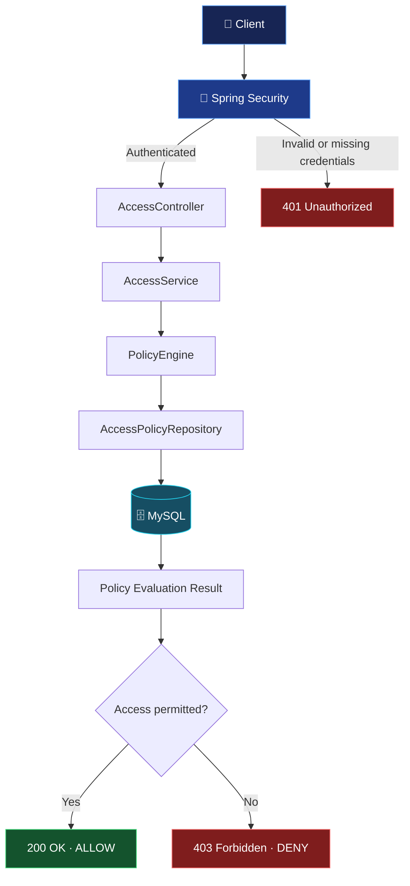
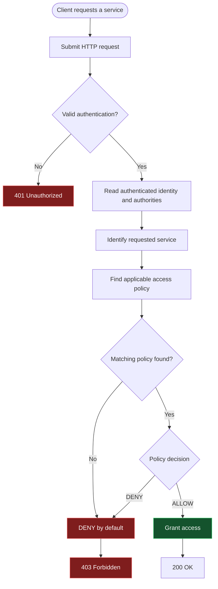
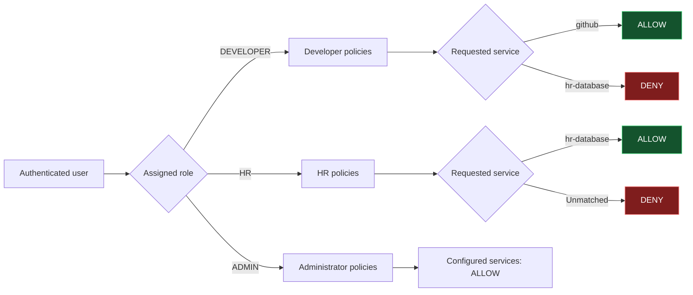
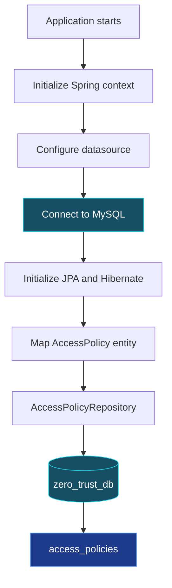
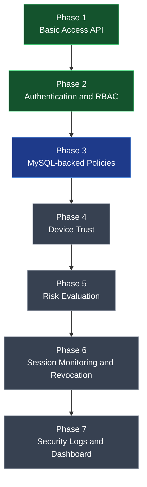

# 🛡️ Zero Trust Service Access Broker

<p align="center">
  <strong>Never Trust. Always Verify. Grant Least Privilege.</strong>
</p>

<p align="center">
  A Java + Spring Boot security project exploring Zero Trust Architecture through authenticated access requests, role-based authorization, database-backed policies, and contextual security evaluation.
</p>

<p align="center">
  
  
  
  
</p>

---

## 🌐 The Vision

What if being inside a network was no longer enough to access a service?

The **Zero Trust Service Access Broker** is a security-focused application designed to evaluate access requests instead of automatically trusting users. It sits between a client and a protected service, authenticates the requester, evaluates applicable access policies, and produces an explicit access decision.

The project is being developed incrementally, beginning with a REST API and evolving toward database-driven policies, device trust, risk evaluation, session monitoring, and security auditing.

> **Core principle:** Access is granted only when the applicable policy explicitly permits it. Missing policies must never become automatic permission.

## ✨ Project at a Glance

| Capability | Description |
|---|---|
| 🔐 Authentication | Spring Security HTTP Basic authentication |
| 🎭 Authorization | Role-Based Access Control (RBAC) |
| ⚖️ Access decisions | Explicit `ALLOW` or `DENY` |
| 🗄️ Persistence | MySQL integration using Spring Data JPA |
| 🧱 Architecture | Controller, service, policy engine, repository |
| 🧪 Verification | Maven tests and API-level testing |
| 🚧 Planned security context | Device trust, risk evaluation, session monitoring, auditing |

**Implementation note:** The MySQL connection, policy table, existing API, authentication, and initial security tests have been verified. Complete database-driven policy evaluation and later roadmap features should be marked as implemented only after their behavior has been tested.

---

# 🏗️ 1. System Architecture

The broker separates HTTP handling, application logic, policy evaluation, and persistence.



### Component responsibilities

| Component | Responsibility |
|---|---|
| `AccessController` | Accepts requests and returns HTTP responses |
| `AccessService` | Coordinates access-check processing |
| `PolicyEngine` | Evaluates the access decision |
| `AccessPolicy` | Models a stored policy |
| `AccessPolicyRepository` | Provides database persistence operations |
| MySQL | Stores access policy records |
| Spring Security | Authenticates users and supplies trusted authorities |

The database-backed repository is the intended source of policy decisions as the integration is completed.

---

# 🔄 2. Access Request Lifecycle

Every request begins with an authenticated identity and a requested service.



### The decision contract

- `401 Unauthorized` — authentication is missing or invalid.
- `200 OK` — the authenticated request is allowed.
- `403 Forbidden` — the request is authenticated but denied.

A client must not be allowed to impersonate another user by supplying a different username or role in the query string.

---

# 🧠 3. Role-Based Access Control

RBAC associates permissions with roles rather than relying on arbitrary client-supplied identities.



### Initial development identities

| Username | Role |
|---|---|
| `shailaj` | `DEVELOPER` |
| `hruser` | `HR` |
| `admin` | `ADMIN` |

These are local development accounts, not production credentials.

### Intended initial policies

| Role | Service | Decision |
|---|---|---|
| `DEVELOPER` | `github` | `ALLOW` |
| `DEVELOPER` | `hr-database` | `DENY` |
| `HR` | `hr-database` | `ALLOW` |
| `ADMIN` | `github` | `ALLOW` |
| `ADMIN` | `hr-database` | `ALLOW` |

An unrecognized role/service combination is denied unless a valid policy explicitly grants access.

---

# 🗄️ 4. Database and Policy Persistence

MySQL provides persistent storage for access policies. Spring Data JPA and Hibernate connect the Java domain model to the relational database.



### Policy data model

The intended `access_policies` table contains:

| Column | Purpose |
|---|---|
| `id` | Unique policy identifier |
| `role` | Role to which the policy applies |
| `service_name` | Requested service |
| `decision` | `ALLOW` or `DENY` |

Inspect the database with:

```sql
USE zero_trust_db;

SHOW TABLES;

DESCRIBE access_policies;

SELECT id, role, service_name, decision
FROM access_policies;
```

Database-backed policy evaluation is complete only when the application actually retrieves and uses stored policy records to make access decisions.

---

# 🧪 5. API Testing

### Endpoint

`GET /access?service=<service-name>`

### Example requests

**Developer → GitHub**

```bash
curl -i -u shailaj:password123 \
"http://localhost:8080/access?service=github"
```

Expected: `200 OK`, if the applicable policy allows access.

**Developer → HR database**

```bash
curl -i -u shailaj:password123 \
"http://localhost:8080/access?service=hr-database"
```

Expected: `403 Forbidden`.

**HR → HR database**

```bash
curl -i -u hruser:hr123 \
"http://localhost:8080/access?service=hr-database"
```

Expected: `200 OK`.

**No authentication**

```bash
curl -i \
"http://localhost:8080/access?service=github"
```

Expected: `401 Unauthorized`.

The sample credentials are illustrative development values. Use the credentials configured in your local application.

### Run automated tests

```bash
./mvnw test
```

The existing Maven test suite has been reported to pass. Additional integration tests should verify that database records, rather than hard-coded rules, determine access decisions.

---

# 🚀 6. Local Setup

## Prerequisites

- Java compatible with the project's Spring Boot version
- MySQL Server
- Git
- Maven or the included Maven wrapper

### Clone the repository

```bash
git clone https://github.com/Shailaz/zero-trust-access-broker.git
cd zero-trust-access-broker
```

### Create the database

```sql
CREATE DATABASE IF NOT EXISTS zero_trust_db;
```

### Configure local credentials

Configure `src/main/resources/application.properties` locally:

```properties
spring.datasource.url=jdbc:mysql://localhost:3306/zero_trust_db
spring.datasource.username=${DB_USERNAME:shailaj}
spring.datasource.password=${DB_PASSWORD}

spring.datasource.driver-class-name=com.mysql.cj.jdbc.Driver

spring.jpa.hibernate.ddl-auto=update
spring.jpa.show-sql=true
spring.jpa.properties.hibernate.format_sql=true
```

Set your environment variables in the terminal:

```bash
export DB_USERNAME=shailaj
export DB_PASSWORD='your_mysql_password'
```

Do not commit your actual credentials to GitHub.

### Start the application

```bash
./mvnw spring-boot:run
```

The API should be available at `http://localhost:8080`.

---

# 🛣️ 7. Roadmap — Before Distributed Systems

The roadmap focuses on progressively strengthening a single-node broker.



*Green indicates earlier phases completed; blue indicates the database-backed policy phase in progress; grey indicates planned work. Update these labels as implementation progresses.*

### Phase 1 — Basic Access API

- Create access request and response models.
- Implement the controller and service layer.
- Return explicit access decisions.

### Phase 2 — Authentication and Authorization

- Configure Spring Security.
- Authenticate users.
- Introduce role-based access policies.
- Obtain identity from trusted authentication context.

### Phase 3 — Database-Backed Policies

- Integrate MySQL and Spring Data JPA.
- Create the policy entity and repository.
- Store policies in MySQL.
- Evaluate stored policies dynamically.
- Enforce default-deny behavior.

### Phase 4 — Device Trust

- Represent device identity and trust state.
- Introduce device posture signals.
- Incorporate device trust into access decisions.

### Phase 5 — Risk Evaluation

- Introduce a risk evaluation component.
- Assess relevant security signals.
- Apply configurable risk-based decisions.

### Phase 6 — Session Monitoring and Revocation

- Track active sessions.
- Monitor changes in authorization context.
- Revoke sessions when access is no longer permitted.

### Phase 7 — Security Logging and Dashboard

- Record access decisions and security events.
- Review denied requests and policy outcomes.
- Display access activity through a dashboard.

---

# 🔐 8. Security Principles

The project is designed around the following principles:

- **Verify explicitly:** authenticate the requester before protected access.
- **Least privilege:** grant only the access that the applicable policy permits.
- **Default deny:** missing policies must not grant access.
- **Trusted identity:** never accept client-supplied roles as authoritative.
- **Auditability:** record security-relevant decisions as logging is implemented.
- **Defense in depth:** use authentication, policy evaluation, and contextual checks together.

This is an educational project, not a production-ready security platform. Production use would require stronger credential management, secure password hashing, HTTPS, database migrations, appropriate auditing, and comprehensive security testing.

---

# 🎯 Learning Outcomes

This project provides hands-on experience with:

- REST API development using Spring Boot
- Authentication and authorization with Spring Security
- Role-Based Access Control
- MySQL integration with Spring Data JPA
- Layered backend architecture
- Access policy evaluation
- Default-deny security design
- Automated testing and iterative implementation

## 📌 Project Status

The project is being built incrementally. The basic access API, authentication, role-based decisions, MySQL connectivity, policy entity/table setup, and existing tests have been verified. Dynamic database-backed decisions and the later roadmap features should be considered in progress until individually implemented and tested.

---

<p align="center">
  <strong>Built to explore Zero Trust security, one verified request at a time.</strong>
</p>
